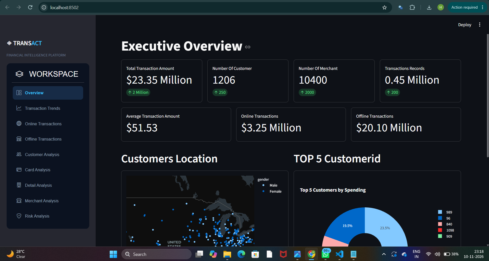
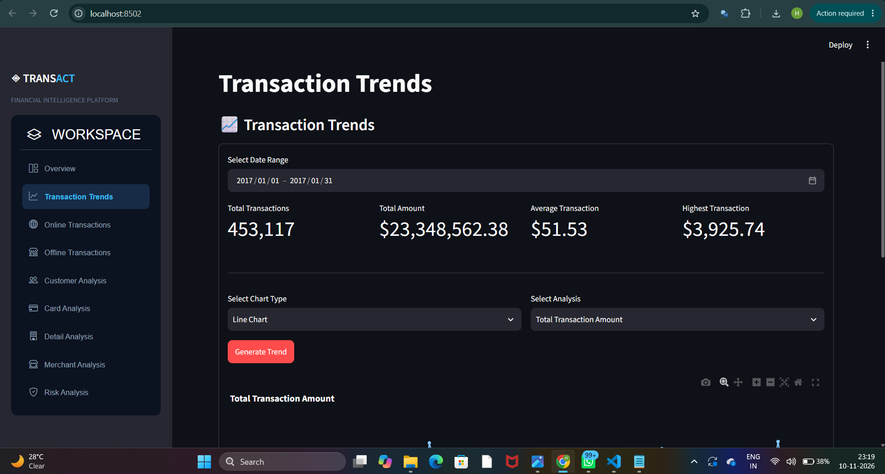
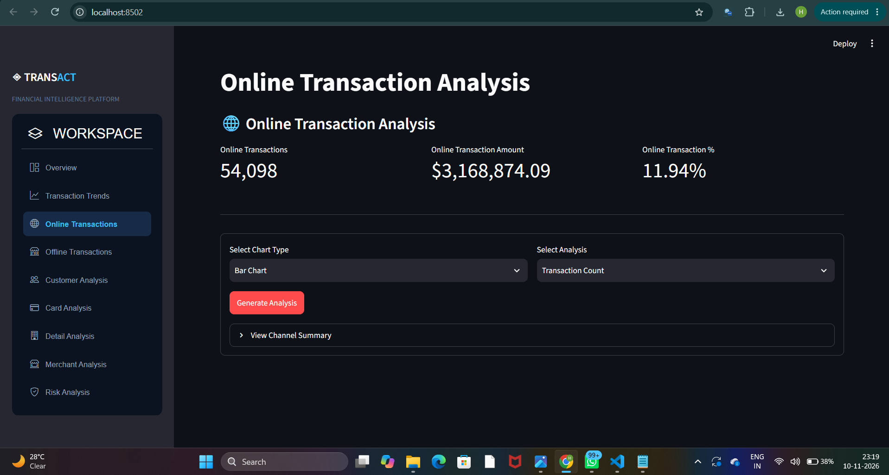
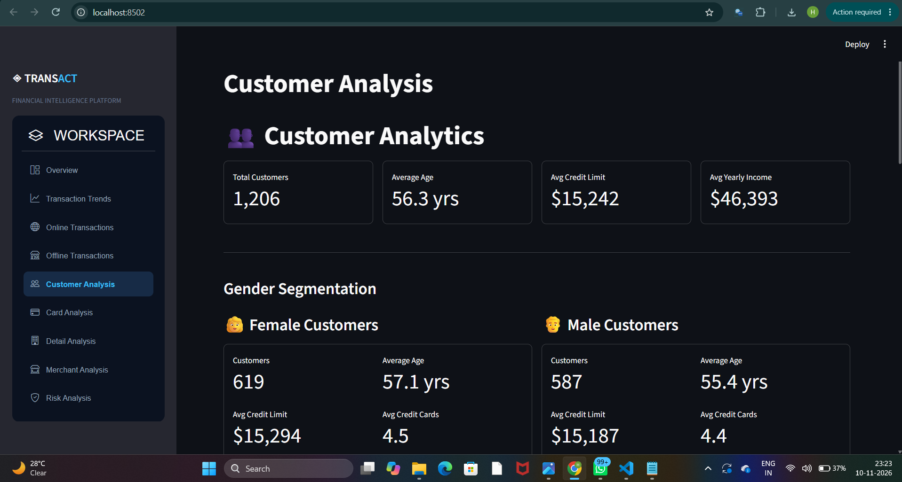
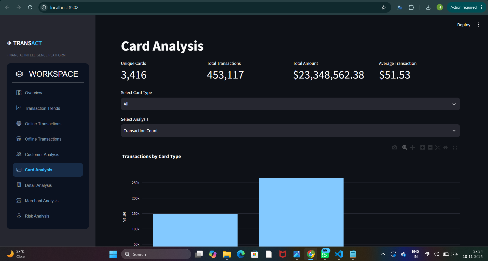
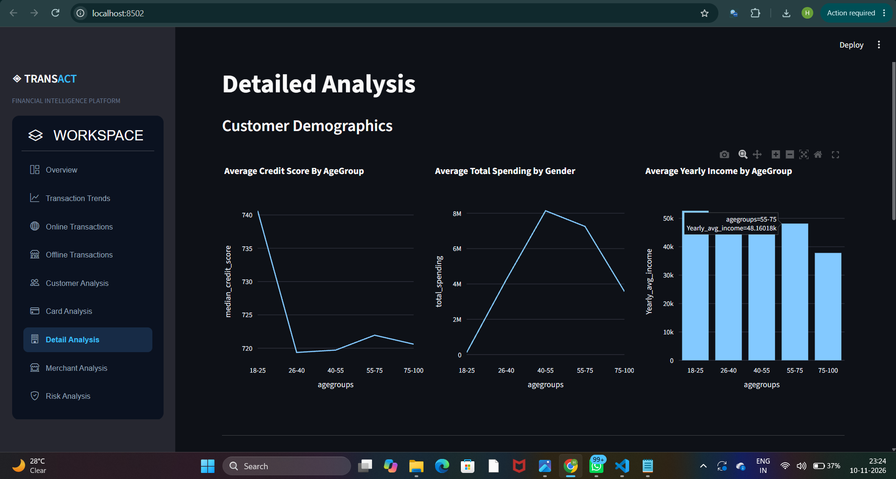
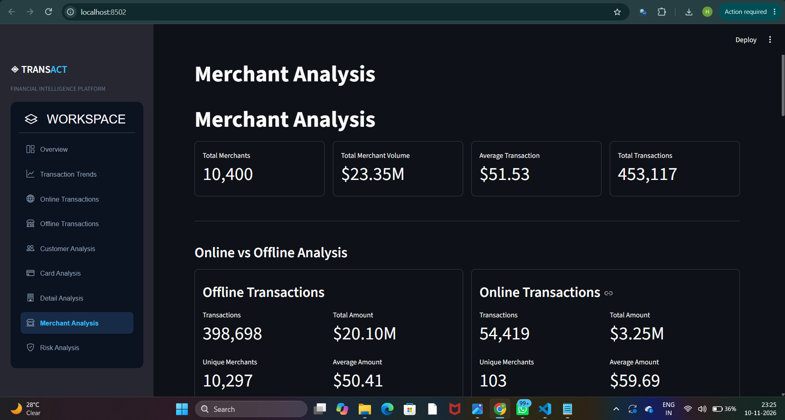
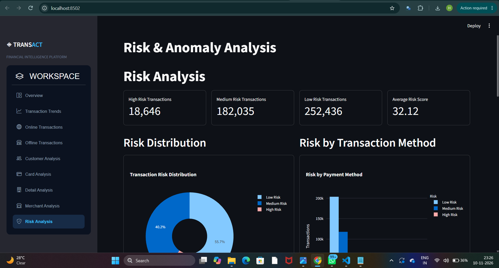

# ◈ TRANSACT: Transaction Intelligence Dashboard

An interactive financial analytics dashboard built with **Streamlit**, **Pandas** and **Plotly**. It takes one month of card-transaction data (January 2017), merges it with customer and card information, cleans it, explores it, and presents the findings across nine dashboard pages: spending trends, online vs offline behaviour, customer segments, cards, merchants and a simple rule-based risk engine.

[](https://transaction-analysis-7pg4vnhhankncigbv6ooer.streamlit.app/)

🔗 **Live Demo:** [https://transaction-analysis-7pg4vnhhankncigbv6ooer.streamlit.app/](https://transaction-analysis-7pg4vnhhankncigbv6ooer.streamlit.app/)

> **Why I built this:** to practise the full analytics workflow end to end: raw data → cleaning → EDA → insights → an interactive app anyone can click through.

---

## 📸 Screenshots

> Add your screenshots to a `screenshots/` folder and keep the file names below (or edit the paths).

| Page | Preview |
|---|---|
| Executive Overview |  |
| Transaction Trends |  |
| Online / Offline |  |
| Customer Analysis |  |
| Card Analysis |  |
| Detail Analysis (age groups) |  |
| Merchant Analysis |  |
| Risk Analysis |  |

---

## 📑 Table of Contents

1. [Project Overview](#-project-overview)
2. [Features / Dashboard Pages](#-features--dashboard-pages)
3. [Tech Stack](#-tech-stack)
4. [Project Structure](#-project-structure)
5. [Installation & How to Run](#-installation--how-to-run)
6. [Dataset](#-dataset)
7. [Data Cleaning](#-data-cleaning)
8. [Exploratory Data Analysis (EDA)](#-exploratory-data-analysis-eda)
9. [Key Insights](#-key-insights)
10. [Risk Scoring Logic](#-risk-scoring-logic)
11. [Limitations & Future Work](#-limitations--future-work)

---

## 🎯 Project Overview

The raw data was spread across three sources: **transactions**, **cards** and **customers**. I merged them into a single table (`Jan2017Trans.csv`) so every transaction row also knows who made it, which card was used and the customer's financial profile.

Because the full dataset is very large, I filtered it down to **one year (2017)**, and the final file used by the app covers **January 2017**. The dashboard reads this file once and every page works off the same cleaned DataFrame (`A`).

---

## ✨ Features / Dashboard Pages

| Page | What you can do |
|---|---|
| **Overview** | KPI cards (total amount, customers, merchants, records), online vs offline volume, map of customer locations, top 5 customers by spending |
| **Transaction Trends** | Pick a date range; view daily total / count / average / max / min and a 7-day rolling average as line, bar or area charts |
| **Online Transactions** | Share and amount of online transactions; choose chart type and metric |
| **Offline Transactions** | Same idea for chip and swipe transactions, with a summary table |
| **Customer Analysis** | Gender segmentation, demographics, financial profile, top 5 male/female spenders, and a **look up any customer by ID** |
| **Card Analysis** | Filter by card type (debit / credit / prepaid); analyse by count, amount, average, brand and chip usage |
| **Detail Analysis** | 5-age-group comparison plus a **dynamic chart builder** (pick X, Y and chart type) |
| **Merchant Analysis** | Top merchants and cities, payment methods, and a **look up any merchant by ID** |
| **Risk Analysis** | Rule-based risk score per transaction, risk distribution, risk by payment method, high-risk transaction table |

---

## 🛠 Tech Stack

- **Python 3.10+**
- **Pandas / NumPy**: cleaning and aggregation
- **Plotly Express**: interactive charts and maps
- **Streamlit**: web app framework
- **streamlit-option-menu**: sidebar navigation

---

## 📂 Project Structure

```
project/
│
├── app.py                  # Entry point: page config, sidebar menu, page routing
├── dataset.py              # Loads CSV, final numeric cleaning, creates age groups + summary table
├── Jan2017Trans.csv        # Cleaned, merged dataset (January 2017)
│
├── pages_code/
│   ├── overview.py         # Executive overview
│   ├── transaction.py      # Transaction trends
│   ├── online.py           # Online transactions
│   ├── offline.py          # Offline transactions
│   ├── customer.py         # Customer analysis
│   ├── card.py             # Card analysis
│   ├── detail.py           # Age-group analysis + dynamic chart builder
│   ├── merchant.py         # Merchant analysis
│   └── risk.py             # Risk & anomaly analysis
│
├── screenshots/            # Dashboard screenshots used in this README
├── requirements.txt
└── README.md
```

### How the pieces talk to each other

1. `app.py` draws the sidebar and checks which menu item is selected.
2. Based on the selection it calls the matching function from `pages_code/`.
3. Each page imports the shared DataFrame `A` (and the age-group summary `sample`) from `dataset.py`.
4. `dataset.py` runs once, so all pages see the same cleaned data.

---

## 🚀 Installation & How to Run

```bash
# 1. Clone the repository
git clone https://github.com/officialhimanshu9964/Transaction-Analysis.git
cd Transaction-Analysis

# 2. (Optional) create a virtual environment
python -m venv venv
source venv/bin/activate        # Windows: venv\Scripts\activate

# 3. Install dependencies
pip install -r requirements.txt

# 4. Start the dashboard
streamlit run app.py
```

The app opens at `http://localhost:8501`.

**`requirements.txt`**

```
streamlit
streamlit-option-menu
pandas>=2.0
numpy
plotly>=5.24
```

> `plotly>=5.24` is needed for `px.scatter_map` (the customer map), and `pandas>=2.0` for the `value_counts().reset_index()` column naming used in the merchant page.

---

## 🗃 Dataset

- **Source:** transaction, card and customer tables merged into one.
- **Period used:** 2017 selected from the full data; the app file covers **January 2017**.
- **Grain:** one row = one transaction.

**Main columns used in the app**

| Group | Columns |
|---|---|
| Transaction | `transaction_id`, `date`, `amount`, `use_chip`, `errors` |
| Merchant | `merchant_id`, `merchant_city`, `merchant_state` |
| Card | `card_id`, `card_type`, `card_brand`, `has_chip`, `card_on_dark_web` |
| Customer | `customer_id` / `client_id`, `current_age`, `gender`, `birth_year`, `birth_month`, `latitude`, `longitude`, `per_capita_income`, `yearly_income`, `total_debt`, `credit_score`, `num_credit_cards`, `credit_limit` |

---

## 🧹 Data Cleaning

Every step below was done so the analysis would not be distorted by bad types, missing values, sensitive fields or noisy columns.

| # | Problem | What I did | Why |
|---|---|---|---|
| 1 | Dataset far too large | Selected only **year 2017** (app uses Jan 2017) | Faster, focused analysis |
| 2 | Data in separate tables | **Merged** transaction, card and customer data | One table for all pages |
| 3 | `date` stored as text | Converted to **datetime** and extracted the **year** | Needed for filtering and time-series charts |
| 4 | Sensitive columns | Dropped `card_number`, `cvv`, `zip`, `mcc` | Privacy and no analytical value |
| 5 | Noisy columns | Dropped `expires`, `num_cards_issued`, `acct_open_date`, `year_pin_last_changed` | They disrupt the analysis without adding insight |
| 6 | `merchant_city = ONLINE` rows had **NaN state** | Set the state value to **"ONLINE"** | These are web purchases with no physical store, so a state does not apply |
| 7 | `errors` column had **NaN** | Replaced NaN with a **"no error"** label | NaN simply meant the transaction had no error |
| 8 | `amount` had mixed signs (`-` and `+`) | Removed the minus sign | Every row is a payment, so the sign carried no extra meaning; positive numbers are easier to aggregate |
| 9 | `amount` stored as text with `$` | Stripped `$` and converted to numeric | Needed for sum / mean / median |
| 10 | `per_capita_income`, `yearly_income`, `credit_limit`, `total_debt` were **object** type | Removed the `$` symbol and converted with `pd.to_numeric(..., errors="coerce")` | So they can be used in maths and charts |
| 11 | No channel label | Added an **online / offline** transaction column | Makes online vs offline comparison simple |
| 12 | Ages too spread to compare | Binned `current_age` into **5 age groups** with `pd.cut` | Cleaner segment analysis |

**Numeric cleaning snippet (from `dataset.py`)**

```python
cols = ['amount', 'per_capita_income', 'yearly_income', 'credit_limit', 'total_debt']

for col in cols:
    A[col] = pd.to_numeric(
        A[col].astype(str).str.replace('$', '', regex=False).str.replace('-', '', regex=False),
        errors='coerce'
    )
```

**Age grouping**

```python
A['agegroups'] = pd.cut(
    A['current_age'],
    bins=[0, 25, 40, 55, 75, 100],
    labels=["18-25", "26-40", "40-55", "55-75", "75-100"]
)
```

---

## 🔍 Exploratory Data Analysis (EDA)

### 1. Summary statistics with `describe()`

I ran `describe()` on the numerical columns and compared the **mean, median and mode** of `amount`. The mean sits well above the median, which is the first sign that the data is **right-skewed**: a small number of very large transactions pull the average up.

```python
A['amount'].describe()
A['amount'].mode()
A['amount'].median()
```

### 2. Skewness

| Column | Skewness | Meaning |
|---|---|---|
| `amount` | **≈ 5** | Highly skewed: lots of small purchases, a few very large ones |
| `per_capita_income` | **≈ 3** | Also highly skewed |

Because of this, **median is a safer measure than mean** for amount and income, and extreme values should be handled carefully (capping, log transform) before modelling.

### 3. Age distribution

A histogram of `current_age` shows that **most customers fall between roughly 38 and 54–60 years old**.

### 4. Age-group segmentation

I split customers into five age groups: **18-25, 26-40, 40-55, 55-75, 75-100**, and built a summary table (`sample` in `dataset.py`) with these columns:

| Column | Meaning |
|---|---|
| `total_spending` | Sum of transaction amounts |
| `avg_spending` | Mean transaction amount |
| `median_spending` | Median transaction amount |
| `customers` | Number of records in the group |
| `Yearly_income` | Total yearly income |
| `Yearly_avg_income` | Average yearly income |
| `Avg_no_cards` | Average number of credit cards |
| `total_credit_limt` | Total credit limit |
| `Avg_credit_limt` | Average credit limit |
| `median_credit_score` | Credit score of the group |

### 5. Card analysis

- Transactions by card type (debit, credit, prepaid)
- Transactions by card brand (AmEx, Discover, MasterCard, Visa)
- Chip vs non-chip usage

### 6. Customer analysis

- Gender split, average age and credit limit by gender
- **Top 5 customers by spending** (overall, and separately for female and male customers) with their transaction records

### 7. Channel analysis

- Online vs offline transaction count, amount and average ticket size

---

## 💡 Key Insights

### Customers & demographics
- 👥 **Most customers are aged about 38–54 (up to ~60).**
- 👩 **Female customers outnumber male customers** in the data.
- 💳 **Females have a slightly higher average credit limit than males.**

### Age groups
- 🧒 **18-25 has the highest average spending and the highest credit score**, and also the highest average yearly income in this dataset.
- 📉 After the 18-25 group, average spending and credit score **decline** with age.
- 💰 **Total spending is highest in the middle band (about 35–54)**, because that band simply has far more customers.
- 👥 **Ages 26-55 contain the most customers** and the largest yearly income overall.
- 🔢 The **number of credit cards increases with age.**
- 🔗 **Higher credit score → higher credit limit.** The two move together.

### Cards
- 🏆 **Debit cards carry the most transactions**, followed by credit cards, then prepaid cards.
- 🏷 Four brands are present: **American Express, Discover, MasterCard and Visa.**

### Channels
- 🛍 **Offline transactions dominate**; fewer customers shop online.

### Data quality
- ⚠️ `amount` (skew ≈ 5) and `per_capita_income` (skew ≈ 3) are **highly skewed**, so medians and robust methods should be preferred.

---

## 🛡 Risk Scoring Logic

The Risk page assigns a **score to every transaction** using simple, explainable rules:

| Rule | Points |
|---|---|
| Card found on the dark web | +30 |
| Amount is above that customer's own average | +30 |
| Transaction had an error | +20 |
| Transaction is online | +10 |

| Total score | Label |
|---|---|
| ≥ 60 | 🔴 High Risk |
| 30 – 59 | 🟠 Medium Risk |
| < 30 | 🟢 Low Risk |

The page then shows counts per level, risk by payment method, a credit-score vs risk scatter plot, and a table of the first 100 high-risk transactions.

---

## ⚠️ Limitations & Future Work

- Only **one month** of data (Jan 2017), so seasonality and long-term trends can't be studied.
- Risk scoring is **rule-based**, not a trained fraud model. Next step: Isolation Forest or a supervised classifier.
- Highly skewed variables could be **log-transformed** or winsorised before any modelling.
- Add **sidebar filters** (date, gender, age group) that apply to every page.
- Cache data loading with `@st.cache_data` to speed up the app.
- Add forecasting for daily transaction volume.

---

## 🙋 Author

Built by **Himanshu Mishra**: [GitHub](https://github.com/officialhimanshu9964) · [LinkedIn](https://www.linkedin.com/in/himanshu-mishra-419954425)

If you found this useful, feel free to ⭐ the repo!